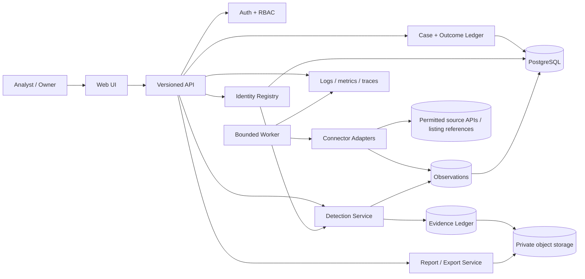
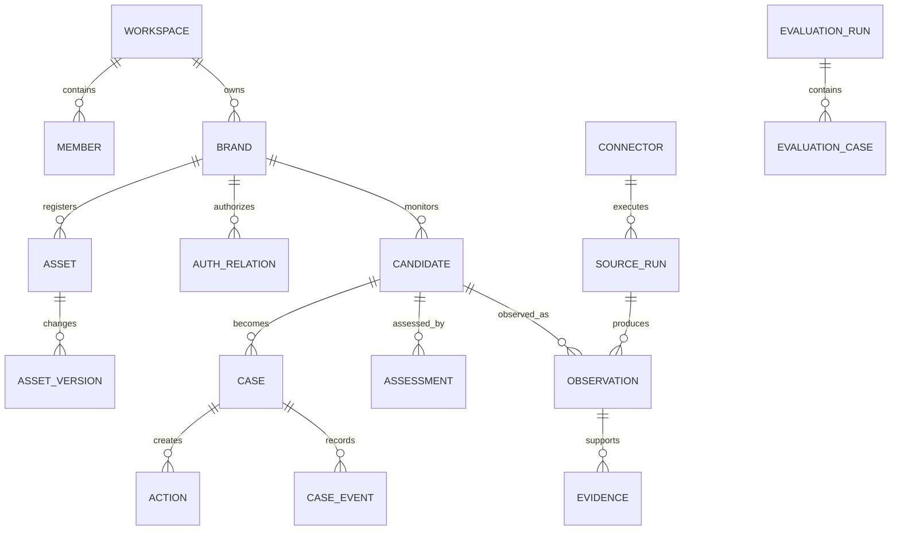

# CAIRNWISE — Definitive Product and Engineering Blueprint

**Working title:** Cairnwise — Evidence-first digital identity risk operations  
**Challenge:** Kampus.VC Digital Risk Protection — Social & App Monitoring  
**Specification version:** 2.0  
**Prepared:** 13 October 2026  
**Status:** Phase 2 implementation is present locally: Supabase/JWT auth boundary, secure user-submitted intake, SSRF-safe collection, source-rights manifests, disabled-by-default Bluesky/Apple contracts, retention/export controls, and an Expo mobile client. Live OAuth/source calls and production deployment remain setup-gated.

**Naming status:** Cairnwise is a provisional working name for this blueprint, prototype, and evaluation materials. This document makes no trademark, company-name, domain, social-handle, or other availability conclusion. Formal clearance remains an open pre-launch task.

> **Integrity rule:** `PS.md` is the immutable evaluation authority. This document is the product and engineering interpretation of that authority. Every statement in this document is labelled implicitly as one of: **verified research**, **proposed target**, **implementation contract**, or **open hypothesis**. Nothing here should be presented in a demo as shipped until it is actually implemented and tested.

## 0. Executive decision

Build a focused, evidence-first digital identity risk operations product for organizations that need to discover and review suspicious social profiles and mobile applications that may impersonate their brand. The first release is not a global crawler and not an autonomous takedown service. It is a complete, reproducible workflow:

`verified brand baseline → permitted observation → explainable comparison → conservative triage → human decision → auditable response → independent recheck`

The product wins the challenge by satisfying every explicit requirement while making the difficult parts visible: official assets are excluded using verified identifiers, look-alike names are handled without declaring guilt, unavailable sources are shown as unavailable rather than “no threats,” and every detection is tied to raw evidence, timestamps, detector versions, and a test case.

### One-sentence product promise

**Cairnwise is designed to help lean brand, fraud, and security teams review suspicious social profiles and mobile-app listings using permitted observations, evidence-linked comparisons, explicit uncertainty, and human-approved actions.**

“Cairnwise” uses a marker/navigation metaphor for the identity registry, evidence trail, coverage markers, and analyst workflow. It does not imply complete visibility, legal verification, autonomous protection, successful takedown, or authoritative attribution.

### What makes this a startup-grade product rather than a generic dashboard

1. **Identity Registry:** a versioned, customer-authorized record of official accounts, apps, publishers, aliases, regions, partners, and exceptions.
2. **Proof Ledger:** every observation, transformation, detector result, analyst decision, and external action is linked and reviewable.
3. **Coverage Contract:** the product declares exactly what each source can observe, when it last succeeded, what is stale, and what is unsupported.
4. **False-Positive Firewall:** exact official identifiers and approved relationships are handled before similarity ranking; name/logo resemblance alone can never produce a malicious verdict.
5. **Replay Lab:** synthetic look-alike robustness tests are separated from independently labelled examples, with detector and dataset versions recorded.
6. **Outcome Ledger:** submitted, acknowledged, removed, reappeared, disputed, and unknown are separate states; “takedown successful” is never inferred from a button click.

### Non-negotiable truth constraints

- A similar name, logo, or description is a **signal**, not proof of impersonation or intent.
- “Not in the registry” means **unknown authorization**, not unauthorized ownership.
- A source returning no records is different from a source being unavailable, rate-limited, or unsupported.
- Synthetic fixtures must be visibly labelled and cannot be used as proof of live coverage.
- A generated explanation may only summarize stored evidence; it may not add uncited facts.
- No automated public accusation, mass-reporting, counterattack, deanonymization, or unsupervised takedown.

## 1. Source-of-truth and evidence model

### 1.1 Official requirements are preserved exactly

The official statement requires a working prototype covering:

- a brand profile containing company/brand name, official logo, official social accounts, official mobile apps, and other identifiers;
- social monitoring for brand impersonation accounts, fake company pages, scam profiles, and similar names/logos/branding;
- app-store monitoring for similar names, brand/logo impersonation, different developers/publishers, and resembling descriptions/branding;
- look-alike name detection for character swaps, added words, and spacing changes without excessive over-flagging;
- an architecture diagram showing data sources, detection logic, storage, and official-asset exclusion;
- a short demonstration or slides.

The weighted evaluation is preserved as:

| Official criterion | Weight | Cairnwise proof artifact |
|---|---:|---|
| Social Media Monitoring | 30 | `T-SOC-01` through `T-SOC-08`; live/permitted adapter or labelled fixture mode; official exclusion and look-alike cases |
| App Store Monitoring | 30 | `T-APP-01` through `T-APP-08`; store metadata fields, publisher mismatch, icon/name/description comparison, official exclusion |
| Brand Profile | 15 | `T-BRAND-01` through `T-BRAND-03`, plus `T-EXC-01..04`; verified assets, aliases, exceptions, provenance, validation |
| User Experience | 15 | `T-UX-01` through `T-UX-08`; readable evidence, setup, error/degraded states, keyboard/accessibility checks |
| Presentation & Demo | 10 | `D-01` seven-minute scenario, architecture diagram, test/evidence manifest |
| Bonus: look-alike names | up to ~5–10 | Character swaps, spacing, inserted words, Unicode confusables, benign exceptions, per-pattern metrics |

### 1.2 Ambiguities and safest interpretation

| Ambiguity | Risky interpretation | Safe interpretation adopted |
|---|---|---|
| “Monitoring” | Scrape every platform regardless of permission | Use a declared connector with documented permission/capabilities plus candidate intake and an explicit fixture fallback |
| “Identify fake” | Claim a binary legal or criminal verdict | Identify a review candidate and show the evidence, counterevidence, uncertainty, and next action |
| “Official apps should not be flagged” | Exclude anything with a similar name | Exclude only verified stable identifiers/publisher records; route official-asset drift to review |
| “App-store monitoring” | Assume one public API covers every store and field | Implement store-specific adapters; record missing fields, terms, quotas, and license/provenance status |
| “AI checked” | Add an opaque score or chatbot | Make core detection deterministic and testable; use AI only for constrained, cited assistance where it adds measurable value |

### 1.3 Current workspace baseline

The workspace now contains a Python/FastAPI application under `cairnwise/`, a relational SQLite foundation schema, executable tests, and a responsive sibling workspace page at `workspace.html`. PostgreSQL, live connector credentials, object storage, and a native mobile project are not present yet. Therefore:

- **Specified:** the capabilities and architecture described in this document.
- **Implemented:** Phase 1 local foundation: authenticated API, workspace membership, brand/assets, deterministic fixture intake, source-run state, observations, assessments, evidence, cases, decisions, report drafts, coverage, and responsive API-driven workspace surface.
- **Verified:** `python -m pytest -q` passes the current API/detector suite; local HTTP health and fixture workflow smoke checks pass. This does not verify live source coverage, production security, or native mobile behavior.

This distinction is deliberate. The first implementation task must not convert this specification into a collection of mock buttons.

## 2. Forensic audit of the previous SOLUTION.md

The previous solution was unusually strong in its evidence-first principles, Coverage Assurance idea, abstention policy, modular-monolith choice, and refusal to overclaim. It still had weaknesses that could cause an AI evaluator or real user to reject the build.

| ID | Finding | Severity | Consequence | Correction in this blueprint |
|---|---|---:|---|---|
| AUD-01 | Social discovery was described as “one permitted path” but no concrete first path was locked | Critical | The product could become URL intake, not monitoring | The first connector is a capability-manifested adapter; Bluesky public actor search is a verified candidate option, while an unavailable connector falls back visibly to fixture/manual intake |
| AUD-02 | App-store source selection was not operationally specific | Critical | Developers may assume an undocumented API or violate terms | Apple public Search/Lookup is a verified probe; Google Play is an observable public listing but not treated as a guaranteed public API; each adapter has an access/rights record |
| AUD-03 | The API list was illustrative, not a contract | High | Frontend, backend, and evaluator can disagree | Exact versioned routes, schemas, status codes, idempotency, and problem responses are defined below |
| AUD-04 | The data model named entities but not constraints or state transitions | High | Evidence, official assets, candidates, and decisions can be mixed into mutable JSON | Relational entities, uniqueness rules, tenant scope, states, and append-only case events are specified |
| AUD-05 | Detection weights and abstention gates were not implementable | High | Different developers could produce incompatible “risk scores” | Deterministic feature families, precedence rules, score semantics, and abstention conditions are defined |
| AUD-06 | The solution did not explicitly distinguish platform metadata reuse from permission to retain/reuse imagery | High | Copyright, terms, or privacy exposure | Store raw URLs and metadata by default; retain images only under a documented legal/permission policy and configurable retention |
| AUD-07 | Exact rubric-to-test traceability was missing | Critical | A feature may be described but invisible to an automated evaluator | Every PS requirement maps to feature IDs, test IDs, and demo evidence in `REQUIREMENTS_TRACEABILITY.md` |
| AUD-08 | Quality targets were ambitious but not calibrated to an actual corpus | Medium | Unsupported percentages look fabricated | Targets are provisional; no metric becomes a claim until the frozen evaluation manifest exists |
| AUD-09 | Roadmap depended on an assumed calendar | Medium | Dates could be stale or impossible | Roadmap is relative and dependency-aware; an optional challenge calendar is a planning input, not a requirement |
| AUD-10 | Public Verify portal created a new impersonation and false-accusation surface | High | A “verified” page could itself be abused | Defer it until domain ownership, revocation, freshness, moderation, and abuse controls are implemented |
| AUD-11 | Graph/campaign language could be interpreted as attribution | High | Weak edges could create reputational or legal harm | Every edge is an observed relation or explicitly labelled hypothesis with evidence IDs; no operator attribution |
| AUD-12 | Security mentioned controls but not adversarial acceptance tests | High | RLS/SSRF/upload claims could remain paper-only | Add cross-tenant, SSRF, file, prompt-injection, rate-limit, audit-tamper, and export tests |

### Decisions retained from the previous solution

The following choices survive the audit: modular monolith first; relational database; private evidence storage; independent similarity/authorization/harm/evidence dimensions; visible source health; abstention; human-approved response; synthetic versus held-out evaluation separation; and explicit non-goals such as dark-web ingestion, autonomous takedowns, malware sandboxing, and multi-agent orchestration.

## 3. Product definition

### 3.1 Target user and paying buyer

**Beachhead hypothesis:** Indian digital-first consumer businesses with a high-trust brand and lean fraud, trust-and-safety, brand, or security teams—especially payments/fintech, marketplaces, travel, e-commerce, consumer SaaS, and gaming.

| User | Job | Product outcome |
|---|---|---|
| Fraud / trust-and-safety analyst | Decide which external identity could harm customers | Prioritized, evidence-linked review queue |
| Brand or marketing lead | Maintain a reliable official presence | Verified identity baseline and exception governance |
| Security lead | Connect external exposure to incident response | Case history, evidence export, and outcome tracking |
| Legal / enforcement reviewer | Submit a defensible platform report | Platform-specific, human-approved evidence pack |
| Customer support lead | Help users distinguish official channels | Later canonical identity page and report intake |

### 3.2 Job-to-be-done

> “When a suspicious account or app appears to use our identity, help me decide quickly and defensibly whether it deserves action, without flagging our legitimate partners or pretending that missing data means safety.”

### 3.3 Product positioning

For lean teams protecting a customer-facing brand, Cairnwise is an evidence-first digital identity risk operations system that joins the official identity baseline, permitted observations, explainable comparison, coverage health, and accountable response. Unlike broad alert feeds, it tells the analyst not only **what was found**, but **what was actually observed, what was not observable, why the candidate is or is not comparable, what evidence is missing, and what happened after the decision**.

### 3.4 Product principles

1. Evidence before eloquence.
2. Coverage before confidence.
3. Observed fact before inferred relationship.
4. Similarity never equals intent.
5. Legitimate exceptions are first-class data.
6. Abstention is safer than unsupported certainty.
7. One real workflow beats a wide fake platform.
8. Every consequential action is human-approved and auditable.
9. The simplest reliable implementation wins.
10. A customer can export, delete, and understand their data.

## 4. Signature differentiators

### D-01 — Identity Twin / Registry

A versioned registry of official accounts, apps, package/bundle IDs, publishers, domains, aliases, logos, regions, agencies, franchisees, resellers, historical identities, and approved exceptions. Each assertion stores who verified it, how, when, source URL, scope, and review expiry.

**Novelty classification:** differentiated product workflow (not a claim of technical novelty).

### D-02 — Proof Ledger

The product stores original observation references, normalized fields, feature outputs, detector versions, counterevidence, reviewer decisions, report submissions, and rechecks as linked records. Human-readable explanations are generated from this ledger, never used as the ledger itself.

**Expected advantage:** lower analyst reconstruction effort and better defensibility than screenshots or chat transcripts.

### D-03 — Coverage Contract

Each connector publishes: supported asset types, fields, collection mechanism, authorization/terms basis, quotas, freshness ceiling, unsupported operations, retry rules, and operational owner. The UI uses controlled states: `operational`, `degraded`, `unavailable`, `unsupported`, `stale`, and `not_evaluated`.

**Expected advantage:** prevents a quiet dashboard from masquerading as a clean brand.

### D-04 — False-Positive Firewall

Official-asset exclusion is a deterministic policy layer before candidate ranking. Exact stable IDs, verified package/bundle IDs, known publisher IDs, and approved relationships are checked first. Conflicts create drift/review findings instead of silently excluding or condemning the asset.

### D-05 — Replay Lab

Two separate tracks: controlled mutation tests for robustness and independently labelled examples for performance claims. The report includes detector version, corpus version, per-pattern precision/recall, false positives, misses, abstentions, and sample limitations.

### D-06 — Outcome Ledger

Case state is not “removed” merely because a report was submitted. The product tracks `draft`, `approved`, `submitted`, `acknowledged`, `removed_observed`, `reappeared`, `rejected`, `appealed`, and `unknown`.

### D-07 — Actionability and accessibility

Every finding has a next action, missing-evidence checklist, keyboard-accessible evidence view, readable status text, and exportable report. Visual graphs are optional; the table/timeline is the primary accessible investigation view. The implementation target is WCAG 2.2 AA, not a vague “modern UI” claim [R11].

## 5. Capability portfolio and prioritization

The portfolio uses a transparent score: **Value 30%, PS contribution 25%, feasibility 20%, differentiation 15%, trust/safety 10%**, each rated 1–5. A score is a prioritization aid, not evidence that a feature works.

### Tier 0 — Mandatory compliance

| ID | Capability | Dependencies | Effort | Acceptance / validation |
|---|---|---|---:|---|
| C-001 | Brand profile with name, logo, social assets, apps, identifiers | none | S | `T-BRAND-01`: saves and reloads a validated profile |
| C-002 | Official social-account registry | C-001 | S | `T-BRAND-02`: stable ID/URL/provenance/region fields persist |
| C-003 | Official app and publisher registry | C-001 | S | `T-BRAND-03`: package/bundle/store/publisher fields persist |
| C-004 | Social candidate discovery/intake | C-002, connector | M | `T-SOC-01`: returns a candidate or an explicit unavailable state |
| C-005 | Social impersonation assessment | C-004, detector | M | `T-SOC-02`: name/logo/branding evidence appears separately |
| C-006 | App listing discovery/intake | C-003, connector | M | `T-APP-01`: returns listing metadata or an explicit source state |
| C-007 | App impersonation assessment | C-006, detector | M | `T-APP-02`: name/icon/publisher/description evidence appears separately |
| C-008 | Look-alike name detection | detector | S | `T-NAME-01..04`: swaps, added words, spacing, Unicode cases |
| C-009 | Official asset exclusion and exception handling | C-002, C-003 | M | `T-EXC-01..04`: official and authorized examples are not misrouted |
| C-010 | Architecture diagram and short demo path | all P0 | S | `D-01`: UI, stored evidence, failure state, and diagram agree |

### Tier 1 — Core product reliability

| ID | Capability | Dependencies | Effort | Acceptance / validation |
|---|---|---|---:|---|
| CORE-001 | Multi-brand workspace | C-001 | M | Tenant-scoped brand CRUD and isolation test |
| CORE-002 | Versioned asset baseline | C-001 | M | Before/after diff and audit event |
| CORE-003 | Authorized partners, regions, agencies, resellers | C-002 | M | Expiry and review state work without auto-condemnation |
| CORE-004 | Candidate deduplication | C-004/C-006 | S | Canonical URL/platform ID collapse into one candidate |
| CORE-005 | Evidence preservation and content hash | C-004/C-006 | M | Hash, timestamps, source, and retention state recorded |
| CORE-006 | Normalized feature trace | detector | M | Original and normalized values both visible |
| CORE-007 | Separate identity / authorization / harm / quality dimensions | detector | M | No single score hides a missing dimension |
| CORE-008 | Analyst queue with reason codes | CORE-007 | S | Sorting/filtering by state, freshness, severity, source |
| CORE-009 | Evidence side-by-side comparison | CORE-005 | S | Official/candidate fields and images have source labels |
| CORE-010 | Abstention and conflicting-evidence state | CORE-007 | S | Missing/contradictory input cannot force a verdict |
| CORE-011 | Case creation, assignment, notes, disposition | CORE-008 | M | Full case lifecycle and event history |
| CORE-012 | Evidence export JSON/CSV/PDF | CORE-005 | M | Export excludes unauthorized tenant data and records export event |
| CORE-013 | Source capability manifest | connector | M | UI lists covered and unsupported operations |
| CORE-014 | Source health and freshness dashboard | connector | M | Failed run is visibly different from zero results |
| CORE-015 | Human-approved report draft | CORE-011 | M | Draft cites evidence IDs and cannot auto-submit |
| CORE-016 | Recheck and outcome ledger | CORE-015 | M | Closure requires observation or provider acknowledgement |
| CORE-017 | Deterministic demo fixtures | none | S | Offline evaluator can reproduce all required paths |
| CORE-018 | Setup and evaluator evidence manifest | all | S | Fresh environment instructions and evidence locations exist |

### Tier 2 — High-value differentiation

| ID | Capability | Dependencies | Effort | Acceptance / validation |
|---|---|---|---:|---|
| DIFF-001 | Evidence-linked relationship edges | CORE-005 | M | Every edge lists evidence IDs and basis |
| DIFF-002 | Candidate timeline and drift view | CORE-005 | M | Changes show old/new values and collection times |
| DIFF-003 | Coverage Gap Report | CORE-014, DIFF-004 | M | Report names blind spots and next checks |
| DIFF-004 | Synthetic look-alike replay suite | C-008 | M | Pattern-level pass/fail and versioned corpus |
| DIFF-005 | Held-out evaluation run | labelled corpus | L | Results include split, labels, sample size, limitations |
| DIFF-006 | False-positive feedback queue | CORE-011 | S | Analyst labels feed review, not silent threshold changes |
| DIFF-007 | Missing-evidence recommender | CORE-010 | S | Suggests stable ID, publisher proof, fresh recheck, or partner confirmation |
| DIFF-008 | Source-change alerts | CORE-014 | M | Connector schema/coverage changes create an audit event |
| DIFF-009 | Evidence citation in generated summaries | AI guardrails | M | Every sentence links to ledger evidence or is omitted |
| DIFF-010 | Detector version comparison | DIFF-004 | S | Version-to-version regressions are visible |
| DIFF-011 | Customer-controlled official identity card | governance | M | Publication requires owner approval, expiry, revocation |
| DIFF-012 | Duplicate customer reports | intake | M | Same candidate merges without losing reporter provenance |
| DIFF-013 | Platform-specific report pack | CORE-015 | M | Fields map to a declared platform process, not generic claims |
| DIFF-014 | Analyst decision calibration view | labels | L | Disagreement and abstention rates are measurable |
| DIFF-015 | “Why not flagged?” audit view | CORE-009 | S | Official exclusion reason is inspectable |
| DIFF-016 | Connector contract test harness | connector | M | Adapter schema, timeout, quota, and failure cases run offline |

### Tier 3 — Production readiness

| ID | Capability | Dependencies | Effort | Acceptance / validation |
|---|---|---|---:|---|
| READY-001 | Tenant-scoped authorization | CORE-001 | M | Cross-tenant read/write tests fail closed |
| READY-002 | Role-based permissions | CORE-011 | M | Reviewer approval separated from analyst drafting |
| READY-003 | Private evidence storage | CORE-005 | M | No permanent public URLs; expiring authorized access |
| READY-004 | SSRF-safe URL handling | C-004/C-006 | M | Private IP, redirect, scheme, DNS rebinding cases blocked |
| READY-005 | Secure file upload pipeline | CORE-005 | M | Signature, size, filename, decoding, and storage controls |
| READY-006 | Secret lifecycle | connector | M | Server-side secret storage, rotation metadata, no logs |
| READY-007 | Rate limits and abuse controls | public intake | S | Per-tenant and anonymous limits are observable |
| READY-008 | RFC 9457 API errors | API | S | Machine-readable error type/status/detail/instance |
| READY-009 | Idempotent jobs and bounded retries | jobs | M | Replayed request does not duplicate cases or reports |
| READY-010 | Structured audit events | all mutations | M | Actor, time, tenant, before/after, reason, request ID |
| READY-011 | Retention/deletion jobs | evidence | M | Deletion is testable and legal hold is explicit |
| READY-012 | Backup and restore rehearsal | database | M | Restore produces a known-good verification report |
| READY-013 | OpenTelemetry traces/metrics/logs | services | M | Source runs and case actions correlate by trace ID |
| READY-014 | Dependency/license inventory | build | S | SBOM and license report generated for release |
| READY-015 | WCAG 2.2 AA review | frontend | M | Keyboard, focus, contrast, labels, status messages checked |
| READY-016 | Secure release checklist | CI/CD | S | Secret scan, dependency scan, smoke/e2e checks block release |

### Tier 4 — Beyond-PS startup expansion

The PS-compliant slice is the evaluation floor, not the entire company. The detailed expansion catalog is in `EXPANSION_CATALOG.md`; it adds 30 stable `EXT-*` capabilities without pretending that they are implemented or required for the challenge score.

The recommended first paid pilot adds:

| Area | Capabilities | Why it matters |
|---|---|---|
| Continuous detection | `EXT-001`, `EXT-002` | Converts one-off intake into scheduled, deduplicated monitoring with change evidence. |
| Analyst operations | `EXT-006`, `EXT-007` | Turns findings into owned, time-bounded, repeatable work instead of an alert feed. |
| Customer trust | `EXT-011`, `EXT-013`, `EXT-014` | Makes coverage, evidence sharing, retention, and deletion inspectable. |
| Reliability and economics | `EXT-016`, `EXT-017`, `EXT-018` | Prevents silent source drift and makes external-source cost controllable. |
| Ecosystem and value | `EXT-021`, `EXT-026`, `EXT-028` | Connects review to an existing ticketing workflow and measures product value without invented savings. |

The near-term portfolio adds multilingual normalization, feedback calibration, collaboration, guarded bulk work, tamper-evident exports, incident operations, notifications, signed webhooks, and guided onboarding. Later work includes domain monitoring, configuration promotion, customer APIs, SSO/SCIM, managed analyst workspaces, and delegated partner workspaces. Each item has an owner, dependency, effort band, and observable acceptance criterion in the catalog.

**Expansion gate:** an `EXT-*` feature enters implementation only when its source permission, data/retention basis, customer value hypothesis, acceptance test, and unit-economics impact are recorded. Expansion features cannot weaken official-asset exclusion, source-health truthfulness, human approval, tenant isolation, or evidence provenance.

### Tier 5 — Research, not roadmap commitment

Research experiments include privacy-preserving label learning, calibrated multimodal models, active learning, graph anomaly detection, brand-specific OCR, and platform-policy change monitoring. Research is not a promise of a production feature; it requires a permitted source, an owner, a test corpus, a customer value signal, and a safety review before entering the build plan.

**Explicit non-goals for the first submission:** dark-web ingestion, unrestricted crawling, autonomous takedowns, malware execution or APK reverse engineering, deepfake attribution, deanonymization, public criminal verdicts, custom model training without labelled data, a graph database, and multi-agent orchestration.

## 6. Complete user journeys

### J-01 — Brand onboarding and baseline proof

1. Owner creates a workspace and brand.
2. Owner enters brand name, website, legal/operating names, logo variants, language/region, aliases, and risk surfaces.
3. Owner adds official social accounts with platform, profile URL, stable ID where available, verification source, account owner, region, and revalidation date.
4. Owner adds official apps with store, listing URL, package/bundle ID, publisher/developer, support URL, and proof source.
5. Owner adds legitimate exceptions: regional pages, franchisees, agencies, resellers, fan/parody pages, legacy apps, and expiry dates.
6. System validates URLs, normalizes names without destroying originals, computes deterministic fingerprints, and creates an immutable baseline version.
7. Completeness report shows verified, self-declared, expired, conflicting, and missing fields.
8. Completion evidence: baseline version ID, validation results, provenance records, and audit event.

Failure paths: invalid URL → field-level error; duplicate stable ID → conflict review; expired partner → `requires_review`; logo parse failure → metadata-only baseline; missing connector permission → onboarding may complete but monitoring is marked unavailable.

### J-02 — Social candidate discovery and review

1. Analyst selects a brand and runs a permitted search or submits a profile URL/fixture.
2. Connector records requested operation, policy basis, source response, collection time, quota status, and supported fields.
3. Candidate is canonicalized and deduplicated.
4. Detector computes exact/near name variants, Unicode security diagnostics, description overlap, avatar similarity, external-link mismatch, stable-ID relation, and source quality.
5. False-Positive Firewall checks official assets and authorized relationships first.
6. UI shows four separate dimensions: resemblance, authorization, potential harm, and evidence quality.
7. Analyst can choose `confirmed_legitimate`, `monitor`, `investigate`, `insufficient_evidence`, or `confirmed_impersonation_under_policy`—the last is an organizational disposition, not a universal legal fact.
8. Case event stores actor, rationale, next action, and evidence IDs.

Failure paths: profile deleted → preserve last permitted observation and show `historical`; access denied → `unavailable`; incomplete profile → `insufficient_evidence`; source timeout → retry with idempotency key, then visible failure.

### J-03 — App listing review

1. Analyst searches an app-store adapter or submits a store URL/identifier.
2. Adapter returns store, listing ID, title, icon reference, developer/publisher, package/bundle ID where available, description, support URL, version/release time, locale, and terms/provenance.
3. Detector compares against the official app registry and brand assets.
4. Publisher mismatch is an independent signal; it is not automatically malicious because legitimate publishers can change or use subsidiaries.
5. Description overlap is shown as highlighted spans and source fields, not as a black-box “AI match.”
6. Analyst reviews, creates a case, and generates a human-approved report pack if appropriate.

### J-04 — Source outage and degraded mode

The dashboard must distinguish: no candidates returned; connector completed; connector degraded; authorization expired; rate-limited; unsupported field; stale observation; and not evaluated. The offline demo must deliberately trigger at least one outage and show that the product does not report “all clear.”

### J-05 — Recheck after action

After a report is submitted, a scheduled/manual recheck records the new observation. Only a fresh absence/changed response or provider acknowledgement can move the case to `removed_observed` or `acknowledged`. If the source is unavailable, the state remains `pending` or `unknown`.

### J-06 — Legitimate exception and appeal

An analyst can mark a candidate as an approved partner, fan/parody context, unrelated organization, or false positive. The change requires a reason, reviewer, scope, and optional expiry. It reduces future queue noise but never deletes the original evidence or silently changes historical decisions.

## 7. Detection and decision specification

### 7.1 Pipeline contract

```text
input → authorize source operation → collect → preserve reference
      → validate/normalize → extract independent signals
      → check official/exception precedence → assess dimensions
      → abstain or rank → human review → action → recheck
```

The pipeline is deterministic for MVP detection. A model may enrich text or summarize evidence only behind a feature flag and schema validator.

### 7.2 Normalization rules

- Preserve `raw_value` and `raw_url` unchanged.
- Store Unicode version and normalization version.
- Use NFC for display-safe canonical text and a documented case-folded form for comparison.
- Compute UTS #39 confusable/skeleton diagnostics and mixed-script diagnostics; never treat a skeleton match as proof [R14].
- For domains, store Unicode and ASCII/Punycode representations using non-transitional IDNA processing where the library supports it; display suspicious script/variant warnings [R15].
- Canonicalize URLs by scheme/host casing, default ports, dot segments, fragment policy, and bounded redirect chain. Keep the original URL.
- Tokenize names/descriptions by locale; retain punctuation and spacing features separately because spacing changes are a required bonus case.

### 7.3 Signal families

**Text/name:** exact normalized match; edit distance; Jaro-Winkler; token set/sort similarity; character n-gram overlap; inserted/deleted words; transposition; separator/spacing changes; Unicode confusable diagnostic; transliteration only when locale is configured. RapidFuzz is a suitable MIT-licensed baseline with explicit preprocessing rather than accidental defaults [R17].

**Visual:** cryptographic hash for exact file identity; perceptual/crop-resistant hash for near duplicate detection; optional OCR; optional embedding only after a labelled evaluation. ImageHash is an inspectable BSD-licensed implementation with tests and multiple perceptual algorithms [R16]. A visual match is evidence of reuse, not ownership or intent.

**Authorization:** stable social profile ID; canonical URL; verified app package/bundle ID; publisher/developer identity; customer-approved partner; source verification record; historical baseline.

**Behaviour/potential harm:** payment or credential call-to-action; external destination mismatch; suspicious support/contact details; impersonation language; active customer-report volume; app-store relationship claims; unusual urgency; evidence of traffic/advertising only when legitimately available.

**Quality:** source permission, source capability, freshness, field completeness, image quality, reproducibility, conflicts, and whether the observation is live, user-submitted, or synthetic.

### 7.4 Official exclusion precedence

1. Exact verified stable identifier + matching platform/store → `authorized` unless drift or compromise evidence exists.
2. Verified package/bundle ID + approved publisher record → `authorized` for the declared store and scope.
3. Exact canonical URL + customer proof → `authorized` for the declared scope.
4. Approved partner/region/agency relation → `authorized_with_scope`; expiry is enforced.
5. Name/logo similarity without identifier proof → **never** excluded and **never** condemned; continue assessment.
6. Conflict between stable ID and visible brand content → `identity_drift` / `manual_review`.
7. Missing registry match → `authorization_unknown`, not `unauthorized`.

### 7.5 Queue-ranking formula (not a truth score)

The UI may show a bounded queue-priority value only for ordering review work:

```text
queue_priority = round(
  (0.35 * identity_resemblance
 + 0.25 * observed_harm
 + 0.20 * authorization_conflict
 + 0.20 * exposure_or_recency)
 * evidence_quality
, 2)
```

All inputs are 0–1 and independently displayed. `evidence_quality < 0.35`, contradictory stable identifiers, or unsupported source operations force `insufficient_evidence` regardless of queue value. The weights are provisional and must be calibrated against a frozen corpus; they are not a claimed scientific probability.

### 7.6 Look-alike name test families

The replay suite must include: `NorthstarPay` / `Northstar Pay`; transposed characters; duplicated/deleted characters; separators; added `support`, `official`, `help`, `login`, or `care`; homoglyph/mixed-script variants; transliterations where configured; legitimate regional/partner names; unrelated common names; and brand names that naturally occur in unrelated organizations. Each pattern reports true positives, false positives, abstentions, and examples.

## 8. Source and connector architecture

### 8.1 Connector manifest

```json
{
  "connector_id": "social.bluesky.actor_search.v1",
  "source": "Bluesky public API",
  "asset_types": ["social_profile"],
  "operations": ["search_profiles", "get_profile"],
  "fields": ["stable_did", "handle", "display_name", "avatar_url", "description", "indexed_at"],
  "auth": "not_required_for_declared_public_queries",
  "terms_reviewed_at": "2026-10-13",
  "freshness_ceiling": "source-dependent",
  "limits": ["search semantics and ranking are source-controlled", "not all content or posts are covered"],
  "failure_states": ["timeout", "rate_limited", "unavailable", "schema_changed"]
}
```

This is a capability declaration, not a promise that all social networks expose the same data. The publicly documented Bluesky actor-search lexicon explicitly describes an unauthenticated profile-search query and the live endpoint returned profile identifiers and metadata during research [R18–R20]. It is therefore a practical first adapter candidate, subject to final terms review before implementation.

### 8.2 App-store source strategy

- **Apple:** the public iTunes Search/Lookup API was successfully probed for an app record and returned app ID, bundle ID, seller, title, description, artwork URLs, version, release time, ratings, and store URL [R5–R6]. The product must still observe Apple’s terms and separate metadata retrieval from image-retention rights.
- **Google Play:** a public listing page was successfully retrieved for an app and visibly exposed title, developer, description, rating, downloads, support details, and update time. The official Google Play Developer API documentation is primarily publishing/app-management oriented, not a universal public search API [R3–R4]. The adapter must therefore be marked source-specific and may use user-submitted listing references or a permitted provider; it must not pretend the publishing API is a public monitoring feed.
- **Fallback:** deterministic JSON fixtures and manual evidence upload are legitimate demo modes only when the UI labels them `synthetic_fixture` or `user_submitted`, shows provenance, and never calls them continuous live monitoring.

### 8.3 Collection safeguards

- No bypass of CAPTCHA, authentication, robots, rate limits, or platform access controls.
- SSRF-safe fetching: HTTPS by default, allowlisted schemes/hosts where possible, private/link-local IP blocking, DNS re-resolution checks, bounded redirects, response-size/time limits, and no credential forwarding.
- The collector stores request ID, source status, response metadata, parser version, and failure reason.
- External source content is untrusted data and is never executed as code.

## 9. System architecture

Use a modular monolith for the first release. Split a connector or worker only when isolation, workload, or team boundaries prove the need. A graph database, queue platform, vector database, or agent framework is not required for the challenge workflow.



### Component responsibilities

| Component | Owns | Must not own |
|---|---|---|
| Web UI | user interaction, status rendering, evidence navigation | trust decisions, secrets, tenant filtering only in browser |
| API | auth context, validation, orchestration, contracts | direct uncontrolled source scraping |
| Identity Registry | official baseline and authorization scope | observed candidate mutable state |
| Connector adapters | source-specific collection and capability reporting | cross-source risk verdicts |
| Observation store | raw/normalized source observations | analyst decisions |
| Detector | deterministic features and versioned assessments | legal conclusion or external action |
| Case ledger | decisions, tasks, evidence links, outcome states | deleting raw evidence silently |
| Worker | bounded async collection/recheck/replay jobs | unbounded retries |
| Evidence storage | private original files/references and hashes | public unauthenticated downloads |
| Report service | evidence-linked exports and drafts | autonomous submission |
| Telemetry | operational signals and correlation IDs | sensitive raw content by default |

### Architecture decision summary

- Relational PostgreSQL over document-only storage because identities, assets, permissions, cases, events, and evidence relations require constraints and joins.
- Modular monolith over microservices because the first risk is workflow correctness, not horizontal scale.
- Deterministic baseline over custom ML because there is no labelled corpus in the workspace.
- Object storage over database blobs for large evidence, with references and hashes in the database.
- Cursor-based async jobs over long synchronous requests for source collection and replay.
- OpenTelemetry-compatible instrumentation because it is vendor-neutral and covers traces, metrics, and logs [R13].

## 10. Data model and invariants



### Required entities and constraints

| Entity | Required fields / rules |
|---|---|
| `workspace` | UUID PK, display name, created time, retention policy, status |
| `member` | workspace FK, identity-provider subject, role, status; unique `(workspace_id, subject)` |
| `brand` | workspace FK, names, website, locale/regions, status; unique `(workspace_id, canonical_name)` |
| `asset` | brand FK, type, platform/store, canonical URL, stable external ID, publisher/developer, authorization state, scope; stable ID unique within `(platform, external_id)` where present |
| `asset_version` | asset FK, raw fields, normalized fields, content hashes, valid-from/to, verified-by, verification source |
| `auth_relation` | brand FK, asset/candidate FK, relation type, scope, expiry, reviewer, reason |
| `connector` | adapter ID/version, capability manifest, terms basis, enabled state |
| `source_run` | connector FK, operation, started/ended, outcome, status code, request ID, record count, error code |
| `candidate` | brand FK, source identity, canonical locator, dedupe key, current review state, first/last seen |
| `observation` | candidate/run FK, observed/collected times, raw reference, normalized snapshot, availability state, content hash |
| `evidence` | observation/assessment FK, evidence type, source locator, excerpt/pointer, retention state, integrity hash |
| `assessment` | candidate/observation FK, detector/version, dimension values, reasons, counterevidence, abstention reason |
| `case` | candidate FK, owner, priority, disposition, opened/closed, closure basis |
| `case_event` | case FK, actor, action, before/after JSON, reason, timestamp, request ID; append-only to application roles |
| `action` | case FK, platform, action type, approval, submission reference, current external state |
| `evaluation_run` | detector version, dataset manifest, split, label policy, start/end, metrics, limitations |

Invariants: all customer-owned rows carry `workspace_id` directly or through a constrained parent; no client-side filter is a tenant boundary; official assets, observations, assessments, and cases are separate records; raw evidence and normalized features have separate retention/access controls; historical assessments are never rewritten when detector versions change.

## 11. API contracts

All routes are under `/v1`. Requests require an authenticated workspace context unless explicitly marked public. Responses use JSON. Mutations accept an `Idempotency-Key` where duplicate execution would create a record or external action. Errors use `application/problem+json` with `type`, `title`, `status`, `detail`, `instance`, and optional field errors, following RFC 9457 [R10].

| Method and route | Purpose | Authorization |
|---|---|---|
| `POST /workspaces` | Create workspace | authenticated creator |
| `POST /workspaces/{wid}/brands` | Create brand | owner/admin |
| `POST /brands/{bid}/assets` | Add official asset | owner/admin |
| `POST /assets/{aid}/versions` | Verify/update baseline version | owner/admin/reviewer |
| `POST /brands/{bid}/connector-runs` | Start permitted discovery/recheck | analyst+ |
| `GET /connector-runs/{id}` | Poll job status | workspace member |
| `POST /brands/{bid}/candidates/intake` | Submit URL/listing/fixture | analyst+ |
| `POST /candidates/{cid}/assessments` | Run detector version | analyst+ / worker |
| `GET /candidates/{cid}` | Candidate summary and state | workspace member |
| `GET /candidates/{cid}/evidence` | Evidence ledger | workspace member; raw download separate |
| `POST /candidates/{cid}/cases` | Create case | analyst+ |
| `POST /cases/{id}/decisions` | Record disposition | analyst; consequential states reviewer-approved |
| `POST /cases/{id}/report-drafts` | Generate evidence-linked draft | analyst+ |
| `POST /cases/{id}/actions/{actionId}/approve` | Approve outbound action | reviewer/owner |
| `POST /cases/{id}/rechecks` | Recheck source/outcome | analyst+ |
| `GET /brands/{bid}/coverage` | Source/freshness/evaluation/resolution report | member |
| `POST /replay-runs` | Start synthetic/held-out run | reviewer/admin |
| `GET /health/connectors` | Bounded source status | admin; no secrets |

### Candidate intake request

```json
{
  "brand_id": "uuid",
  "input_type": "profile_url|app_listing_url|store_id|fixture_id",
  "value": "https://example.invalid/candidate",
  "source_mode": "permitted_connector|user_submitted|synthetic_fixture",
  "locale": "en-IN",
  "requested_operations": ["metadata", "icon"],
  "idempotency_key": "client-generated-key"
}
```

The response is `202 Accepted` for a job or `201 Created` for a fully stored user-submitted observation. It must include `candidate_id`, `observation_id` when available, `source_status`, `availability`, `next_action`, and `evidence_mode`.

### Assessment response

```json
{
  "candidate_id": "uuid",
  "detector": {"name": "cairnwise-baseline", "version": "0.1.0"},
  "dimensions": {
    "identity_resemblance": {"value": 0.82, "signals": ["name_near_match", "avatar_phash_near_match"]},
    "authorization": {"state": "unknown", "signals": ["no_stable_id_match"]},
    "potential_harm": {"level": "moderate", "signals": ["external_link_mismatch"]},
    "evidence_quality": {"value": 0.76, "missing": ["publisher_verification"]}
  },
  "decision": {"state": "review_required", "queue_priority": 0.62},
  "supporting_evidence_ids": ["uuid"],
  "counterevidence": [],
  "abstention_reason": null
}
```

## 12. AI and intelligent processing

AI is not the product’s authority layer. The baseline detector is deterministic and explainable. Optional model capabilities are:

- language normalization or transliteration suggestions;
- OCR assistance on permitted images;
- evidence-linked summary drafting;
- analyst question answering over the current case ledger.

Every model call has an input schema, maximum size, timeout, cost ceiling, model/provider/version, prompt/template version, output JSON schema, and fallback. Untrusted profile descriptions, app descriptions, screenshots, and external pages are data—not instructions. Prompt injection tests must verify that embedded text cannot cause a tool call, data exfiltration, permission change, or verdict override. Model output is discarded if it contains uncited claims, malformed fields, or an unsupported recommendation.

The system never says “the model is confident.” It reports detector evidence, source quality, and uncertainty separately. NIST AI RMF is used as a risk-management reference for govern, map, measure, and manage activities; it is not claimed as a certification [R7–R8].

## 13. Security, privacy, and trust model

### 13.1 Assets and trust boundaries

Assets: customer identity baselines, logos and app metadata, raw screenshots, source credentials, analyst decisions, reports, and audit events. Boundaries: browser ↔ API; API ↔ database/object store; worker ↔ external source; tenant ↔ tenant; human reviewer ↔ outbound report; untrusted source content ↔ detector/LLM.

| Threat | Example | Required mitigation | Verification |
|---|---|---|---|
| Broken tenant isolation | Analyst reads another workspace’s evidence ID | Database RLS/authorization on every read/write; direct-object tests | `SEC-TENANT-01..06` |
| SSRF | Candidate URL targets cloud metadata or internal admin | Scheme/host/IP/redirect policy, DNS rebinding defense, egress controls | `SEC-SSRF-01..08` |
| Malicious upload | Polyglot image, decompression bomb, active content | Allowlist types, signature validation, size/decode limits, re-encode, private storage, sandbox where justified | `SEC-UPLOAD-01..07` |
| Credential leakage | Connector token in browser or logs | Server-side secret store, redaction, rotation, least privilege | `SEC-SECRET-01..05` |
| Prompt/indirect injection | External description tells copilot to export data | Treat source text as untrusted, tool allowlist, no write tools, schema validation | `SEC-AI-01..06` |
| False accusation | Weak similarity exported as criminal claim | Controlled vocabulary, human approval, evidence/counterevidence, appeal, no public verdict | `TRUST-01..05` |
| Abuse / spam | Anonymous mass candidate submissions | Authentication, quotas, rate limits, dedupe, moderation, audit | `SEC-ABUSE-01..05` |
| Audit tampering | Reviewer edits history | Append-only case events for application roles, restricted admin access, export hash | `SEC-AUDIT-01..04` |
| Dependency compromise | Vulnerable parser or package | pinned versions, vulnerability scan, SBOM, signed/reproducible release evidence | `SEC-SUPPLY-01..04` |

Controls are aligned to OWASP ASVS 5.0, OWASP SSRF/file-upload/secrets guidance, NIST CSF 2.0, and NIST Privacy Framework. These references inform design; they do not constitute a claim of certification or compliance [R9, R12, R23–R25]. PostgreSQL row-level security is useful but defaults to deny only when enabled and correctly tested; owners/superusers can bypass it, so application authorization and database policy tests remain required [R21].

### 13.2 Privacy and data governance

- Collect only fields needed for the declared monitoring operation.
- Prefer business identity metadata; individual/executive monitoring is a separate controlled scope.
- Store source terms/purpose and retention class on each connector/evidence type.
- Default retention: normalized metadata 180 days; raw images/screenshots 30 days; audit events 365 days; configurable by customer/legal hold. These are proposed defaults, not legal advice.
- Deletion must remove database references and objects, except documented legal holds; deletion jobs produce proof without retaining deleted content.
- Customer content is not used to train a shared model by default.
- Exports are tenant-scoped, watermarked with evidence provenance, and audited.
- Public Verify is deferred until domain ownership, revocation, moderation, freshness, and abuse handling exist.

## 14. Reliability, performance, and observability targets

These are provisional engineering targets, not measured results.

| Metric | MVP target | Measurement |
|---|---:|---|
| Interactive registry/case read p95 | ≤ 500 ms excluding object download | seeded 10k-row database, 20 concurrent users |
| Candidate assessment p95 | ≤ 3 s for metadata-only deterministic path | fixed fixture corpus; report machine/runtime |
| Async connector job completion | status visible within 2 s of acceptance | job integration test |
| Retry amplification | ≤ 3 attempts per operation | failure injection |
| Successful configured source runs | ≥ 95% over a defined pilot window, by adapter | source-run ledger; unsupported excluded from denominator |
| Freshness | customer-configured window; stale count always shown | due/completed/failed/stale counts |
| Tenant isolation | 0 cross-tenant reads/writes | automated adversarial tests |
| Accessibility | WCAG 2.2 AA target for implemented UI | keyboard + automated + manual review |
| Evidence completeness | 100% of applicable contract fields or explicit missing reason | contract validator |
| Verified outcome rate | report only after pilot; never invent target | outcome ledger |

Use structured logs, metrics, and traces with workspace/case/source-run/request IDs but no raw credentials or unnecessary personal content. OpenTelemetry is the instrumentation boundary; the backend can be changed later [R13]. Alerts: connector error-rate spike, stale candidates, parser/schema drift, queue age, failed deletion, unauthorized access attempt, export failure, and evaluation regression.

## 15. Testing and verification strategy

### Test layers

1. Unit: normalization, URL canonicalization, UTS39 diagnostics, name mutation, hash distance, scoring gates, state transitions.
2. Contract: connector schemas, capability manifests, provider failure mappings, RFC 9457 errors.
3. Database: constraints, migrations, RLS, uniqueness, transaction boundaries, deletion/retention.
4. Integration: source adapter → observation → detector → case → export.
5. End-to-end: browser onboarding, social flow, app flow, outage, false positive, recheck.
6. Security: SSRF, upload, auth/RBAC, tenant isolation, prompt injection, rate limits, secret scanning.
7. Accessibility: keyboard-only, focus order, labels, contrast, screen-reader status, responsive layout.
8. Evaluation: frozen synthetic replay and held-out labelled corpus reported separately.

### Requirement verification matrix

| Test ID | Requirement | Scenario | Pass evidence |
|---|---|---|---|
| T-BRAND-01 | Brand Profile | Create brand with name, logo, official social/app assets | DB record, UI screenshot, API response |
| T-BRAND-02 | Brand Profile | Invalid URL, duplicate ID, missing provenance | field errors and audit log |
| T-SOC-01 | Social Monitoring | Search/submit official + look-alike + unrelated profiles | source run, candidate records |
| T-SOC-02 | Social Monitoring | Similar name/logo/branding explanation | evidence IDs and feature trace |
| T-SOC-03 | Social Monitoring | Official account and approved partner | no false alert / exception state |
| T-SOC-04 | Social Monitoring | unavailable/rate-limited source | explicit degraded/unavailable UI |
| T-APP-01 | App Monitoring | Retrieve app listing metadata | observation and source provenance |
| T-APP-02 | App Monitoring | Similar name/icon/description, different publisher | separate signals and review state |
| T-APP-03 | App Monitoring | Official package/bundle/publisher | excluded by stable identifier |
| T-APP-04 | App Monitoring | inaccessible listing/missing fields | missing/unsupported state, not zero-risk |
| T-NAME-01 | Bonus | character swap | detected/reported with original text |
| T-NAME-02 | Bonus | inserted “support/official” word | detected but not automatically malicious |
| T-NAME-03 | Bonus | spacing/separator variation | detected with feature reason |
| T-NAME-04 | Bonus | benign common name and regional partner | not over-flagged due to counterevidence |
| T-UX-01 | UX | complete setup to first case | ≤ defined pilot task time, no dead end |
| T-UX-02 | UX | source failure | recovery/action visible |
| T-UX-03 | UX | evidence comprehension | analyst identifies why candidate is queued |
| T-UX-04 | UX | keyboard/accessibility | no critical accessibility blocker |
| D-01 | Presentation | seven-minute Northstar Pay scenario | video/live run plus evidence manifest |

No test in this matrix is marked passed until implementation produces the named evidence. The full matrix remains **partially executed**: the current foundation evidence is recorded in `IMPLEMENTATION_PHASES.md` and the targeted API/detector tests; live-source, PostgreSQL/RLS, upload/SSRF, accessibility, and browser end-to-end cases remain open.

## 16. Real-world demonstration plan

Use a fictional brand, `Northstar Pay`, to avoid making unsupported accusations about a real organization. Fixture set:

1. Official social profile with stable ID and exact URL.
2. Official iOS/Android app records with package/bundle and publisher.
3. Authorized regional account.
4. Benign fan/parody page.
5. Subtle look-alike profile: spacing + character swap + copied bio + unrelated destination.
6. Suspicious app listing: similar title/icon/description + different publisher.
7. Unrelated common-name profile/app.
8. Deliberately failing connector response.

Seven-minute sequence:

1. 0:00–0:45 — show baseline, provenance, exceptions, completeness.
2. 0:45–1:50 — run social discovery/intake and show source capability.
3. 1:50–2:45 — open evidence, normalized values, counterevidence, abstention/review state.
4. 2:45–3:45 — run app listing flow and show publisher/icon/description comparisons.
5. 3:45–4:35 — show official exclusion and benign exception side-by-side.
6. 4:35–5:20 — generate a human-approved evidence report; no autonomous submission.
7. 5:20–6:10 — trigger outage; show Coverage Contract status and recovery.
8. 6:10–7:00 — run Replay Lab and close with test evidence, not an invented accuracy percentage.

The evaluator must be able to distinguish live/permitted, user-submitted, and synthetic data from UI labels, API fields, source runs, and database state.

## 17. Reproducible deployment and implementation roadmap

### Minimum implementation stack

Next.js/TypeScript frontend; Python/FastAPI/Pydantic API and detector; PostgreSQL; private object storage; a bounded worker; RapidFuzz/imagehash or equivalent with license review; Playwright/Pytest-style tests; structured logs and OpenTelemetry. Use provider-native auth/secrets only after the team locks its deployment choice. Do not install infrastructure that the workflow does not require.

### Relative roadmap

| Stage | Objective | Exit evidence | Excluded |
|---|---|---|---|
| 0 — Access and corpus | Lock first social/app sources, permissions, fixture schema, label policy | connector manifest, source probe, frozen fixture manifest | broad integrations |
| 1 — PS-compliant vertical slice | Brand → social/app intake → detection → readable result | all Tier 0 tests and demo fixture run | response automation |
| 2 — Trust layer | exceptions, evidence ledger, cases, exports, outage handling | case evidence pack and failure-path tests | graph/LLM complexity |
| 3 — Signature differentiation | Coverage Contract, Replay Lab, outcome ledger | coverage report and regression evidence | unsupported global claims |
| 4 — Hardening | tenant isolation, retention, upload/SSRF, observability, accessibility | security/accessibility/reproducibility checklist | production certification claims |
| 5 — Pilot validation | 5–10 design-partner interviews and scoped pilot | measured analyst effort, useful-finding rate, source limitations, willingness-to-pay evidence | fabricated market metrics |

Critical path: permitted source → fixture/evaluation corpus → evidence contract → detector → official exclusion → case workflow → demo/evaluation. If the source cannot be secured, switch to fixture + user-submitted evidence and state that continuous monitoring is not implemented.

### Reproducible setup contract for the future implementation

The repository must document: supported runtime versions; install command; environment variables with placeholders only; database migration and seed commands; fixture import; local start commands; test commands; connector permission setup; demo steps; data deletion command; and known limitations. A fresh evaluator must be able to run the offline PS-compliant flow without proprietary credentials.

## 18. Startup validation and commercial model

### Beachhead hypothesis

Start with one brand per pilot for Indian digital-first consumer businesses. The paid problem is not “AI score generation”; it is reducing analyst time, duplicate investigation, false-positive burden, and uncertainty about source coverage and response status.

### Validation questions

- What was the last real impersonation incident and what evidence was missing?
- Which sources are legally/permitted to monitor and which fields matter?
- Who owns the budget and who approves reports?
- How many hours per week are spent searching, deduplicating, and preparing reports?
- What false-positive rate makes the tool unusable?
- Is a coverage/audit report valuable even when no threats are found?
- Will the buyer pay for software, managed review, or both?

### Packaging hypothesis

Pilot: one brand, declared sources, weekly report, case workflow, fixed review sessions. Starter: one brand, core adapters, capped observations, evidence cases, monthly coverage report. Growth: multiple brands, scheduled rechecks, exports and integrations. Enterprise: custom retention, SSO/RBAC, connector scope, support, and audit terms. Prices must be tested after connector/API and analyst costs are known; the previous ₹5,000–₹15,000/month idea is a hypothesis, not a market fact.

### Defensibility that can compound

Customer-authorized identity histories; high-quality false-positive and exception labels with permission; source reliability records; detector regression corpus; evidence/outcome workflow integration; and vertical policy packs. None is an automatic moat. The moat exists only if customers repeatedly trust and use the data.

## 19. Risks, assumptions, and open questions

### Highest-risk assumptions

1. A first social source can be used lawfully and provides enough profile metadata to demonstrate the required workflow.
2. A first app-store source provides enough title/icon/publisher/description data under acceptable terms.
3. Customers can supply stable official identifiers and legitimate exceptions.
4. A deterministic baseline can reduce review effort without unacceptable false positives.
5. Buyers value coverage transparency and outcome tracking, not only alert volume.
6. A small team can implement and test the vertical slice before adding breadth.

### Kill/pivot criteria

- No permitted source path → ship evidence intake plus fixtures and reframe as evidence operations, not continuous monitoring.
- No labelled cases → do not claim accuracy; focus on transparent features and Replay Lab.
- False positives dominate analyst time → move ranking behind conservative abstention and prioritize baseline/exception management.
- Buyers only want managed takedowns → consider a services-assisted pilot while keeping evidence/outcome software as the core.
- No measurable analyst or response benefit → stop feature expansion and revisit problem/segment.

## 20. Final readiness assessment

**Specification readiness:** Ready to begin implementation after the team locks the first source adapter, fixture/evaluation corpus, retention policy, and deadline.  
**Implementation readiness:** Blocked until those four decisions are made.  
**Product readiness:** Not ready; there is no application code or end-to-end test in the workspace.  
**Evidence readiness:** Research-backed for the listed standards, competitor positioning, Apple/Google app metadata probes, Bluesky API shape, RapidFuzz, ImageHash, and security/accessibility guidance; not evidence of Cairnwise product performance.  
**Submission gate:** Do not claim a feature in a presentation until its test ID has actual evidence. The strongest submission is a smaller working vertical slice with visible limitations, not a larger undocumented feature list.

Companion artifacts keep the specification auditable:

- `REQUIREMENTS_TRACEABILITY.md` — PS requirements → capabilities → tests → demo evidence.
- `RESEARCH_REGISTER.md` — source URLs, access dates, evidence quality, findings, and implications.
- `RISK_REGISTER.md` — risk, likelihood, impact, mitigation, owner, trigger, residual risk.
- `ARCHITECTURE_DECISIONS.md` — alternatives and decisions.
- `VALIDATION_PLAN.md` — experiments, dataset policy, quality targets, and demonstration procedure.
- `IMPLEMENTATION_ROADMAP.md` — dependency-aware build sequence and exit criteria.
